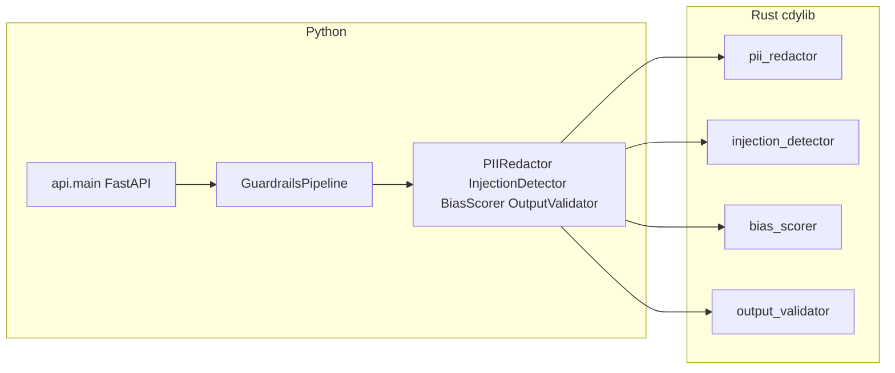
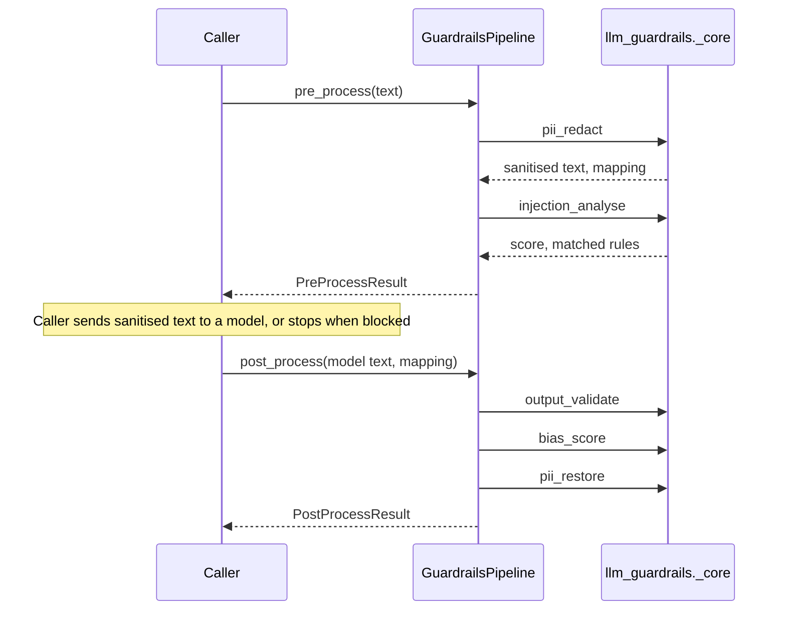

<div align="center">

# 🦀 Ferroguard

**Rust checks for Python. Install `ferroguard`. Import `llm_guardrails`.**

A library that redacts some PII, scores a few prompt patterns, and checks model
output with a small set of rules. The checks run in Rust. A FastAPI app in `api/`
shows the pipeline. It does not call a model.

[](LICENSE)
[](https://www.rust-lang.org)
[](https://docs.astral.sh/uv/)
[](https://pypi.org/project/ferroguard/)
[](https://melroyanthony.github.io/llm-guardrails/)

</div>

## ⚡ Technology Stack and Features

- 🦀 **Rust** on the stable channel in `rust-toolchain.toml`, with the `regex` crate.
  - 🔗 [PyO3](https://pyo3.rs/) and [maturin](https://www.maturin.rs/) build `llm_guardrails._core`.
  - 🕵️ Eight injection patterns, scored after the text is normalised.
  - 🎭 A small bias scorer and a small output checker. Neither one is a proof of safety.
- 🐍 **Python** 3.11, 3.12, 3.13, or 3.14. Development uses 3.14 (`.python-version`).
  - 📦 [uv](https://docs.astral.sh/uv/) installs the interpreter and the locked environment.
  - 🧱 Pydantic v2 models on the Python side of each guard.
  - 🐍 The PyPI project is `ferroguard`. The import name stays `llm_guardrails`.
- 🚀 **[FastAPI](https://fastapi.tiangolo.com/)** demo in `api/`. It does not call a model.
  - 📏 `text` is at most 8000 characters (`422` above that).
  - 📦 A request body over 32768 bytes is `413`.
  - 🗂️ Placeholder maps stay in the process: at most 1024 maps, 262144 UTF-8 bytes
    in total, and 65536 bytes for one map. A map that does not fit is `503`.
- 🧪 **CI** on pull requests and on pushes to `main`.
  - 🐍 ruff, mypy on `llm_guardrails/`, and pytest on Python 3.11 and 3.14.
  - 🎡 One abi3 wheel, imported on 3.11 and 3.14.
  - 🦀 `cargo fmt`, `cargo clippy -D warnings`, and `cargo test`.
  - 🔒 `Security` runs cargo-deny and pip-audit. `CodeQL` analyses Python and Rust
    with `build-mode: none`.

## 🚀 How To Use It

### Requirements

| Tool | What you need |
| --- | --- |
| [Rust](https://rustup.rs/) | rustup. Opening the repo selects `stable` from `rust-toolchain.toml`. |
| [uv](https://docs.astral.sh/uv/getting-started/installation/) | Installs Python and the dev environment. |
| Python | 3.11, 3.12, 3.13, or 3.14. `uv sync` reads `.python-version` and uses 3.14. |

### Install

```bash
pip install ferroguard
```

```python
import llm_guardrails
```

| Name | Value |
| --- | --- |
| PyPI project | `ferroguard` |
| Import | `llm_guardrails` |
| Wheel | abi3, one wheel for 3.11 through 3.14 |

The same install and a short example are on the
[docs site](https://melroyanthony.github.io/llm-guardrails/).

### Run the demo

```bash
uv sync --all-extras
uv run uvicorn api.main:app --reload
```

| What | Where |
| --- | --- |
| 🩺 Health | http://localhost:8000/health |
| 📖 Interactive API docs | http://localhost:8000/docs |
| 📄 OpenAPI document | http://localhost:8000/openapi.json |

`GET /health` returns `{"status":"ok","version":"<installed>"}`. That version is the
installed `ferroguard` distribution. Maturin reads it from `Cargo.toml`. It is not
hard-coded in `api/main.py`.

```python
from llm_guardrails import GuardrailsPipeline

pipeline = GuardrailsPipeline()
pre = pipeline.pre_process("My email is alice@example.com. Summarise this report.")

if pre.blocked:
    print(pre.injection.matched_rules)
else:
    print(pre.sanitised_text)
    post = pipeline.post_process("Paris is the capital of France.", pre.pii_mapping)
    print(post.final_text)
    print(post.bias.score)
    print(post.validation.is_valid)
```

That sanitised text is `My email is <<EMAIL_1>>. Summarise this report.`

`GuardrailsPipeline` takes its switches as constructor arguments (`pii_enabled`,
`injection_enabled`, `bias_enabled`, `output_validation_enabled`, `injection_threshold`,
`validation_rules`). `.env-template` lists similar names. Nothing in the library or the
demo reads that file.

The demo does not call an LLM. `POST /guard/full` uses `simulated_llm_response` when you
send one, and otherwise echoes a stub that quotes the sanitised prompt.

### Demo API

FastAPI builds the document from the route functions.

| Method | Path | What it does |
| --- | --- | --- |
| `GET` | `/health` | Status and the installed package version |
| `POST` | `/guard/input` | PII placeholders, an injection score, and an opaque `pii_mapping_id` |
| `POST` | `/guard/output` | Validation, bias score, and PII restore for that id |
| `POST` | `/guard/full` | Input guards, then a stub or a caller-supplied response, then output guards |

`text` over 8000 characters is `422`. A body over 32768 bytes is `413`, and the message
names that limit. An unknown field is `422`.

`/guard/input` does not return the placeholder map. A non-empty map that fits stays in
this process for 15 minutes, under `pii_mapping_id`. The store holds at most 1024 maps,
262144 UTF-8 bytes in total, and 65536 bytes for one map. A map that does not fit is
`503`, and that call stores nothing. An empty map is not stored, and `pii_mapping_id`
is null. `/guard/full` does not store a map: restore happens inside that request, and
its `pii_mapping_id` is null. `/guard/output` takes the id, pops the map, and rejects a
client-supplied `pii_mapping`. A second call with the same id is `404`, the same as an
unknown or expired id. Raw PII is not in the input response. The store is not shared
across workers, and it is lost on restart. `GuardrailsPipeline` still returns the map
to in-process callers.

A blocked prompt (the injection score is at least the threshold, default `0.5`) comes
back with `"blocked": true`. `/guard/full` then has no output section.

```bash
curl -s -X POST http://localhost:8000/guard/input \
  -H 'Content-Type: application/json' \
  -d '{"text": "My SSN is 123-45-6789. What is the weather?"}'
```

### Demo image

The image in `Dockerfile` builds a wheel on `python:3.12-slim`, installs that wheel plus
FastAPI and `uvicorn[standard]>=0.54.0,<1.0`, and serves `api.main:app` on port 8000.
The Python and uv image references include a digest. Dependabot's weekly `docker` group
opens a pull request when those digests move. The Rust channel stays `stable`. The image
downloads rustup-init `1.29.3` and checks its SHA256 before running it. Refreshing that
installer means changing `RUSTUP_VERSION` and both architecture checksums in the same
edit. Dependabot does not change those checksums. The image does not load `.env-template`.

```bash
docker build -t llm-guardrails .
docker run --rm -p 8000:8000 llm-guardrails
curl -s http://localhost:8000/health
```

PyPI publishing stays in the release workflow. It is not a separate tag workflow.

## 🧩 How the pieces fit





## 🔒 Security

What the library actually does:

- **PII.** `src/pii_redactor.rs` replaces matches with `<<LABEL_N>>` and returns the map.
  Labels are `SSN`, `CREDIT_CARD`, `EMAIL`, `PHONE`, `IP_ADDRESS`, `DATE_OF_BIRTH`, and
  `NAME` (two consecutive capitalised words). A card number is a run of 13–19 digits
  with optional spaces or dashes that also passes the Luhn check. An SSN whose area is
  `000`, `666`, or `9xx`, whose group is `00`, or whose serial is `0000` is left as
  written. A phone-shaped slice inside a longer digit run is left alone. A name or date
  of birth is redacted only when a context word sits next to it (`name`, `born`, `DOB`,
  `Dr.`, `Ms.`, or `Dr`/`Ms` followed by a capitalised word). `Jane Doe called` is not
  redacted. There is no switch that restores a match of every title-case pair or every
  date. `PIIRedactor` and `GuardrailsPipeline` take `allow_entities` and `deny_entities`
  (pipeline: `pii_allow_entities`, `pii_deny_entities`). An empty allow list raises
  `ValueError`, and so does a label that is not one of those seven. On `PIIRedactor`
  those two attributes are read-only after construction. Restoration is a straight
  string replace of the placeholders.
- **Injection.** Eight regular expressions (`ignore_previous`, `reveal_system_prompt`,
  `role_play_attack`, `developer_mode`, `encoding_evasion`, `do_anything_now`,
  `system_role_injection`, `token_smuggling`). Text is normalised first: NFKC, invisible
  characters removed, common homoglyphs folded, and spaced-out letters collapsed
  (`i g n o r e`). The `DAN` token is uppercase only, so "Dan" is not a jailbreak;
  "do anything now" still matches in any case. The score is the highest matching weight,
  plus `0.10` when two or more rules match, capped at `1.0`.
- **Bias.** A handful of stereotype patterns, a gendered-token imbalance check, and an
  absolute-generalisation pattern. The score is a weighted sum of those hits, capped at
  `1.0`.
- **Output.** Optional max length, a top-level JSON `type` and `required` check (not full
  JSON Schema), a hedging-phrase score exposed as `hallucination_score`, and
  required/blocked keyword checks. A hedging hit is a `warning` and does not by itself
  clear `is_valid`.

The map of original PII stays in memory and is handed back to the caller. The library does
not write it to disk. Discarding the map is how a caller drops those values. None of this
is a complete privacy, safety, or compliance programme. Pair it with the controls your
deployment actually needs, and do not send raw prompts to a model provider you have not
reviewed.

CI rejects known-vulnerable and yanked Rust crates (`deny.toml`) and known-vulnerable
Python dependencies (`pip-audit`). Private reports go through
[SECURITY.md](SECURITY.md).

## 📚 Documentation

- 📖 [Docs site](https://melroyanthony.github.io/llm-guardrails/) — install, guards, limits, and the local demo
- 🛠️ [CONTRIBUTING.md](CONTRIBUTING.md) — setup, tests, lint, and pull requests
- 🔖 [RELEASING.md](RELEASING.md) — how a push to `main` is versioned, tagged, and published
- 🔒 [SECURITY.md](SECURITY.md) — private vulnerability reports
- 📖 [CODE_OF_CONDUCT.md](CODE_OF_CONDUCT.md) — Contributor Covenant 2.1
- 🤖 [AGENTS.md](AGENTS.md) — conventions for contributors and coding agents

`Release` runs on a push to `main`. It commits `.version` and `CHANGELOG.md`, pushes that
commit to `main` without `--force`, then pushes the tag. The same run builds the abi3
wheels and sdist and publishes them to PyPI. `Docs` builds the static site on pull
requests and on pushes to `main`. `Scorecard` runs on `main` and on a weekly schedule.

## 🤝 Contributing

Two places to change when a guard's behaviour changes: the Rust function in `src/`, and
the wrapper in `llm_guardrails/`, which should stay a conversion to a Pydantic model.
`api/main.py` should keep calling `GuardrailsPipeline` rather than growing its own checks.

```bash
uv sync --locked --all-extras
uv run ruff check .
uv run ruff format --check .
uv run mypy llm_guardrails
uv run pytest
cargo fmt --check
cargo clippy --all-targets -- -D warnings
cargo test
python3 scripts/release_subject.py --self-test
python3 scripts/release_publish.py --self-test
```

`uv sync --locked --all-extras` builds the extension and installs the `api` extra.
pytest and ruff come from the default `dev` dependency group, not an extra. pytest needs
that build because the wrappers import `llm_guardrails._core`. `cargo test` runs the Rust
tests without Python.

With [just](https://just.systems/) installed, `just setup` syncs the lockfile and runs
`maturin develop`. `just ci` runs setup, lint, pytest, `cargo test`, the two release
self-tests, and `python3 scripts/test_guardrails.py`. GitHub CI also runs mypy. `just ci`
does not.

pytest covers the wrappers, `GuardrailsPipeline`, and the demo routes (`tests/`).
`cargo test` covers the regex helpers in `src/`.

## 📄 License

Ferroguard is licensed under the terms of the [MIT license](LICENSE).
Copyright (c) 2026 Melroy Anthony.
