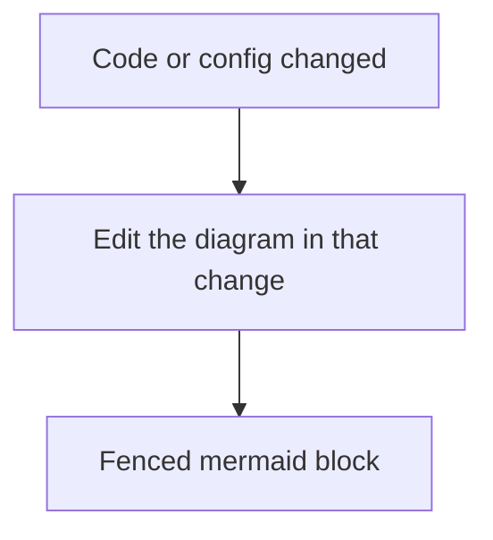

# Diagrams

Draw the picture in the same change as the prose. A fenced `mermaid` block is the source. Do not replace it with an exported image.

## When a diagram beats prose

Use one when the reader has to hold order, branches, or several parties in their head:

- Architecture: containers, adapters, or a boundary
- A flow with a real branch (opt-in, allow, deny)
- A sequence: who calls whom, in order
- A state machine: status values and the event that moves each one
- A PR or branch path: issue, review, merge, release

A short list or a table is enough for three items with no order and no branch. Do not add a diagram there.

## Which type

| You are showing | Fence |
| --- | --- |
| Architecture, adapters, or a decision | `flowchart` |
| Calls in order | `sequenceDiagram` |
| Status and the event that moves it | `stateDiagram-v2` |
| Tables and foreign keys | `erDiagram` |

PR body examples live in `git-workflow` [`references/pr-mermaid-and-templates.md`](../git-workflow/references/pr-mermaid-and-templates.md).

## How to write it

1. One path. Split a second concern into a second fence. Stay under about 15 nodes.
2. Labels use the names in the code: file, command, status, variable. A label that the code does not have is a wrong diagram.
3. Put the fence in the doc that a reader of that system opens. Update that fence in the same change that changes the code it describes.

## Completion

- [ ] The type matches the table
- [ ] Every node name exists in the code or the doc it describes
- [ ] The fence is `mermaid`, not an image
- [ ] A behavior change in that flow updated the diagram
