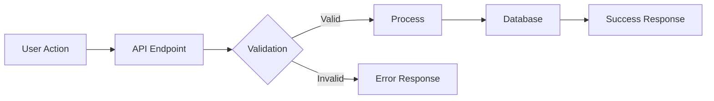

## GitHub Issue Creation

### Issue Templates

#### Feature Issue
```bash
gh issue create \
  --title "feat: <short description>" \
  --body "$(cat <<'ISSUE_EOF'

## Summary
- Add POST /api/v1/auth/register endpoint
- Email validation and bcrypt password hashing
- JWT token issued on successful registration

Closes #${ISSUE_NUM}

## Motivation
<Why is this needed? What problem does it solve?>

## Acceptance Criteria
- [ ] <criterion 1>
- [ ] <criterion 2>
- [ ] <criterion 3>

## Technical Notes
<Any implementation hints, constraints, or dependencies>

## Design


## Labels
- `architecture`
- `decision`
ISSUE_EOF
)" \
  --label "architecture"
```

## Bug Description
<What is happening vs what should happen>

## Steps to Reproduce
1. <step 1>
2. <step 2>
3. <step 3>

## Expected Behavior
<What should happen>

## Actual Behavior
<What actually happens>

## Environment
- OS: <os>
- Version: <version>
- Stack: <Python/Node>

## Error Output
```
<paste error here>
```

