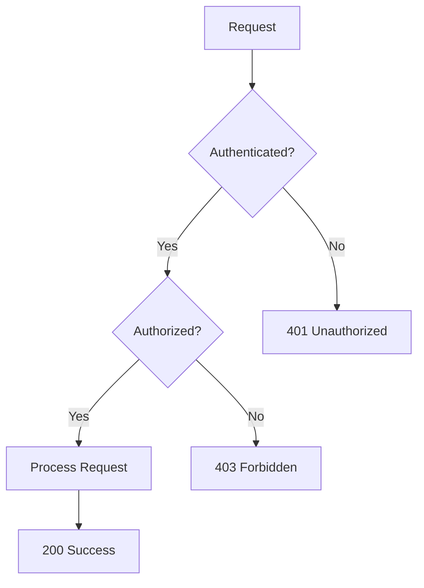
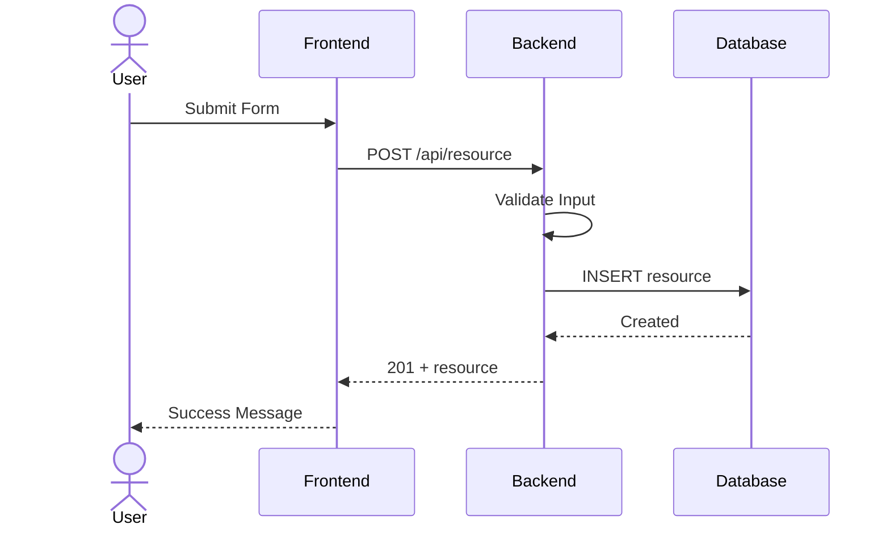
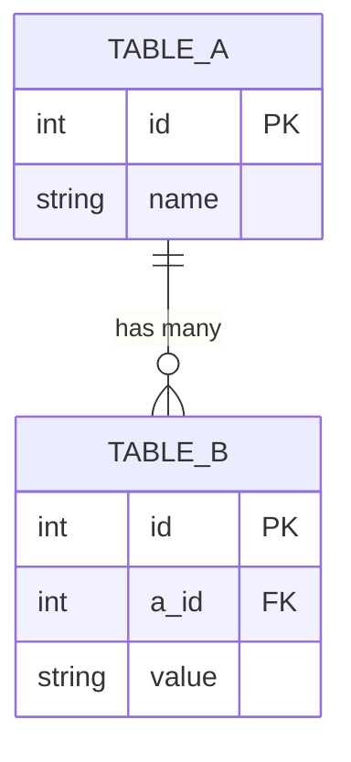
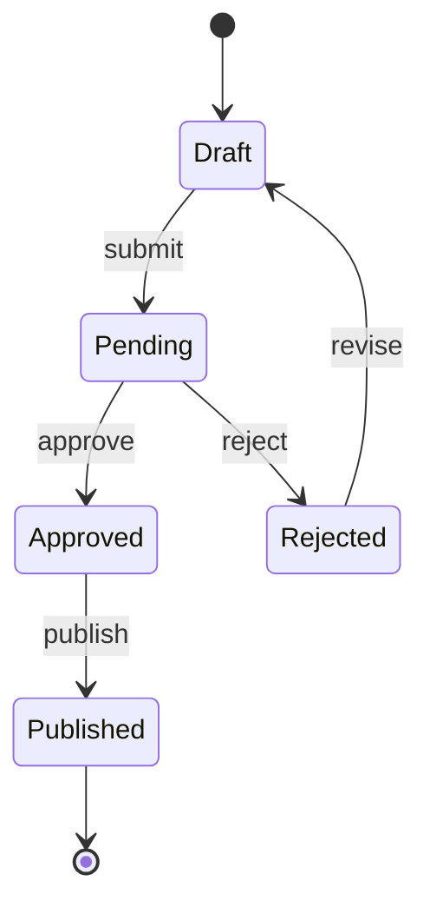
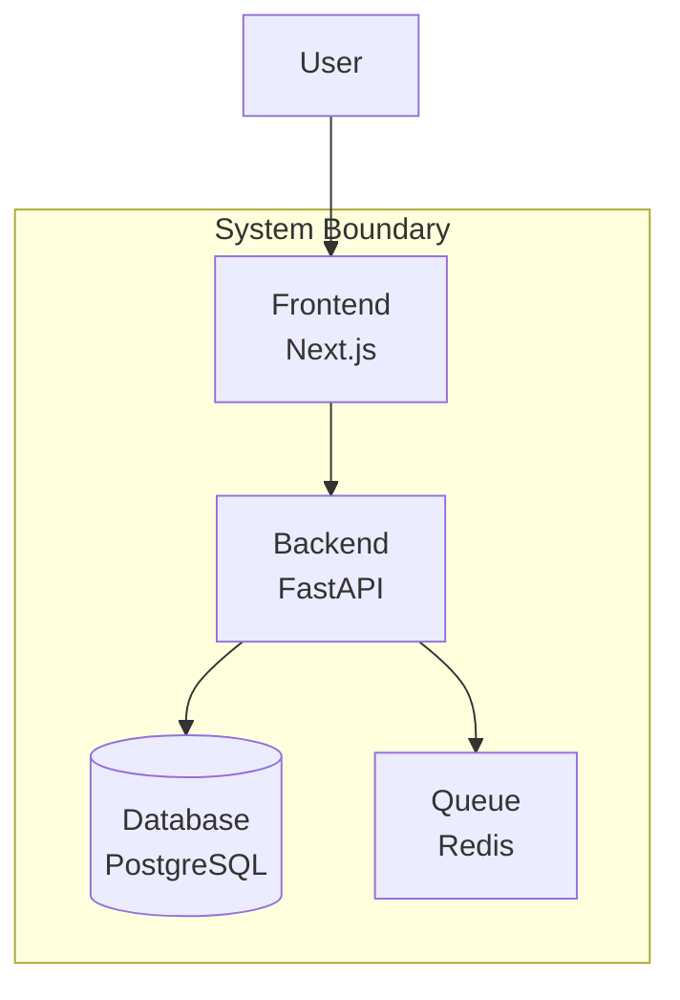

## Mermaid Diagram Types for PRs

### 1. Flowchart (Decision Logic)

### 2. Sequence Diagram (API Flow)

### 3. Entity Relationship (Database Changes)

### 4. State Diagram (Status Transitions)

### 5. C4 Container (Architecture Changes)

