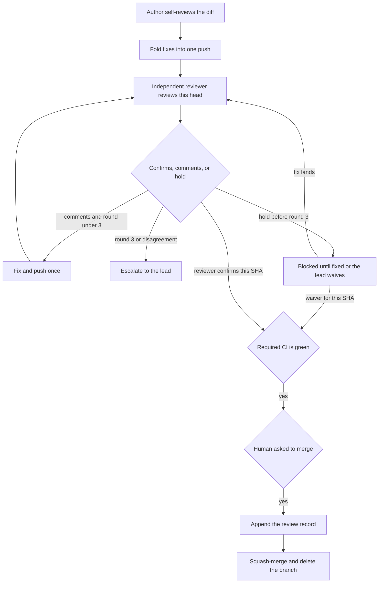

# Review loop to squash-merge

Take a pull request from the author's self-review to squash-merge. The independent reviewer reviews the current head. The lead takes an escalation or waives a hold. `/resolve-review` is the comment-fix procedure. The merge command stays `gh pr merge <number> --squash --delete-branch`, and only after the human asks.

The project's agent instructions name the reviewer and the lead under `## Review`. In this catalog that file is `AGENTS.md`.

## When to use

- A diff is about to be offered for review
- The independent reviewer has commented, confirmed, or held
- A confirmation or waiver quoted a head SHA that is no longer the head

A staff reading of a diff during implementation is `code-reviewer`. This loop is the pull-request gate.

## Loop

A round is the independent reviewer's pass on one head SHA. The first head they review is round 1. A further review of that same SHA stays in the round. The next round starts after a push, when they review the new head. The author's self-review is not a round.



1. **Self-review.** Completion: the authoring agent has read the diff for correctness, edge cases, tests, security, and docs, and every fix from that reading is in the one push that will be reviewed.
2. **Request review of that head.** Completion: the author has mentioned the independent reviewer in the `Channel` from `## Review`, with the pull request URL and this full 40-character head SHA, and the request names the depth below. That message is the request. It is not confirmation. When `GitHub login` is set, also add that login with `gh pr edit <number> --add-reviewer`. A blank login is enough when `Channel` is set.
3. **Apply the depth.** Completion: the strictest depth that matches the diff is the one requested. A later review may widen the depth.
4. **Confirmation, another round, hold, or escalation.** Completion: the independent reviewer has explicitly confirmed this full head SHA, or the comments are fixed in one push and the next round has started, or a hold or escalation is recorded and the merge stays blocked. A hold or a request-changes message never counts as confirmation.
5. **Merge gate.** Completion: required CI is green and either the reviewer has confirmed this full head SHA or the lead has waived a hold on this full head SHA.
6. **Record, then squash-merge.** Completion: the human asked, the head SHA is unchanged, the pull request body contains the record below, and the squash-merge has been requested.

A new commit on the pull request, including a merge from the base, voids a confirmation and a waiver. Return to step 2.

## Review depth

The strictest matching row wins.

| Depth | When | What the reviewer covers |
| --- | --- | --- |
| Full | The diff touches auth or secrets, a file format, a wire contract, a migration, a release workflow or release script, or a major dependency bump | The whole change, with the sensitive surface checked for correctness, compatibility, tests, and security |
| Quick | Every changed file is a lockfile, or every changed file is documentation | The diff is only that, and it matches its description |
| Lighter | Everything else | Correctness, missing tests, and the risky parts of the diff |

- **File format.** A schema, grammar, parser, or serializer that defines a persisted or exchanged document.
- **Wire contract.** A public API, event, or protocol shape exchanged with another process or client.
- **Auth or secrets.** Authentication, authorization, or secret handling.
- **Migration.** A schema or data migration.
- **Release workflow or script.** A workflow or script that tags, publishes, or ships a release.
- **Major dependency bump.** The same package moves to a higher major version in a dependency manifest or a GitHub Actions `uses:` pin. `0.x` moving to `1.0.0` or above counts. A package added with no previous version is not a bump. A lockfile-only diff is the quick pass.
- **Lockfile.** `Cargo.lock`, `uv.lock`, `poetry.lock`, `package-lock.json`, `pnpm-lock.yaml`, `yarn.lock`, `bun.lock`, `go.sum`, `composer.lock`, `Gemfile.lock`, `packages.lock.json`.
- **Documentation.** Markdown and the docs site. One non-doc file removes the quick pass.

## Where the project names the reviewer

```markdown
## Review

- Independent reviewer: the team's SWE reviewer
- GitHub login:
- Channel: the team room
- Lead: the Engineering Lead
```

The author mentions the independent reviewer in `Channel` with the pull request URL and the full head SHA. That request is not confirmation. Confirmation is a later message from the Independent reviewer named under `## Review`, posted in that channel, that quotes the full head SHA and explicitly confirms it. A hold or a request-changes message never counts. The pull request body record is the evidence that stays on the pull request. A blank `GitHub login` is fine when `Channel` is set. This catalog records that block in `AGENTS.md`. The independent reviewer reviews every pull request. Depth changes the pass. It does not skip the review.

## Confirmation, hold, and escalation

Confirmation is a message from the Independent reviewer named under `## Review`, posted in `Channel`, that quotes the exact full head SHA and explicitly confirms it. The author's review request, a note from the lead, a hold, and a request-changes message do not confirm, even when they quote that SHA. When `GitHub login` is set, a GitHub review from that login confirms only when it also quotes the SHA and explicitly confirms. An approval that omits the SHA leaves the gate closed.

A hold blocks the merge. Silence is waiting, and the merge stays blocked. The author fixes a hold with a new push, which starts the next round. The lead waives a hold by naming the hold and quoting the full head SHA the waiver covers. That SHA may merge. When the project names no lead, a hold waits for a fix and an escalation goes to the human.

A disagreement is any conflict between the author and the independent reviewer about the diff, the depth, or whether the head can merge. On any disagreement, stop the fix loop and escalate. Also escalate when round 3 is not a confirmation of the current head, including a hold on that round. Tell the lead the pull request URL, the full head SHA, the round count, the open findings, and both positions when they disagree. Wait for the lead. A later head they ask for starts a new loop at round 1.

## Record before squash-merge

Re-read the head SHA after the human says yes. When it differs from the confirmed or waived SHA, return to step 2 and skip the merge.

On confirmation, append this line and the findings the reviewer recorded for that SHA. When that review records none, write `Findings: none.`

`<reviewer>` is the `Independent reviewer` value from `## Review`.

```text
Reviewed by <reviewer> at `<full sha>`

Findings:
- <finding, or none>
```

On a lead waiver, append a waiver record instead of the confirmation line:

```text
Lead waived the hold at `<full sha>`

Findings:
- <finding, or none>
```

Leave earlier lines in the body. If the body already contains the record line for this head SHA, leave it unchanged. Append with `gh pr edit` so the existing body stays. A failed edit blocks the merge.

```bash
# PR_NUMBER is the pull request number.
HEAD_SHA=$(gh pr view "$PR_NUMBER" --json headRefOid --jq '.headRefOid')
BODY=$(gh pr view "$PR_NUMBER" --json body --jq '.body // ""')
# If BODY already contains the record line for HEAD_SHA, stop.
# Otherwise append that record to BODY and run:
# gh pr edit "$PR_NUMBER" --body-file pr-body.md
```

## CI

Required CI is part of the merge gate. When the project is Rust, CI includes cargo-deny. When it is Python, CI includes pip-audit. When the repository is public, CI includes CodeQL for `python` and, on a Rust repository, `rust` with `build-mode: none`. Private and internal repositories skip that job. A skipped job is not reported as `codeql (python)` or `codeql (<language>)`, so a private repository does not require those check names. The snippets live in [`ci-cd-github-actions.md`](../devops/references/ci-cd-github-actions.md). A pull request that adds or changes CI for one of those stacks includes the matching job. The merge waits on the required checks the repository actually runs.

## Common rationalizations

| Rationalization | Reality |
| --- | --- |
| "The diff looks fine, so the reviewer can start" | The authoring agent reviews correctness, edge cases, tests, security, and docs, and folds those fixes into one push first. |
| "An older approval still covers this head" | Confirmation quotes the current full head SHA. A new push voids it. |
| "The reviewer said LGTM, so the SHA can be inferred" | The quote is the full 40-character head SHA. |
| "A quiet reviewer means the gate is open" | Silence leaves the merge blocked. The lead's waiver is what clears a hold. |
| "A blank GitHub login means a person must route the review" | Confirmation is a message from the Independent reviewer in that channel that quotes the full head SHA and explicitly confirms it. The author's request, a lead note, a hold, and a request-changes message do not confirm. |
| "Round 4 will land it" | Round 3 without a confirmation goes to the lead. A disagreement goes to the lead at once. |
| "Docs plus a migration is a quick pass" | The strictest depth wins. A migration, release script, contract, file format, auth change, or major bump is a full review. |
| "The body can skip the findings" | The confirmation or waiver line and the findings are on the pull request body before squash-merge. |

## Red flags

- Asking for review before the self-review fixes are in that push
- Merging while required CI is red or still running
- Merging on a confirmation or waiver for an older SHA
- Treating the author's request, a lead note, a hold, or a request-changes message as confirmation because it quotes the SHA
- Merging over a hold the lead has not waived for this head SHA
- Opening a fourth fix round, or patching through a disagreement
- Squash-merge before the body records this head SHA

## Verification

- [ ] Self-review fixes are in the one push that was reviewed
- [ ] The requested depth is the strictest match, and the independent reviewer reviewed that head SHA
- [ ] Round count is recorded. Round 3 without confirmation, and any disagreement, went to the lead
- [ ] Required CI is green, and the named independent reviewer explicitly confirmed this full head SHA, or the lead waived a hold on it
- [ ] The pull request body contains `Reviewed by <reviewer> at \`<sha>\`` or `Lead waived the hold at \`<sha>\``, plus the findings
- [ ] The human asked before `gh pr merge <number> --squash --delete-branch`
